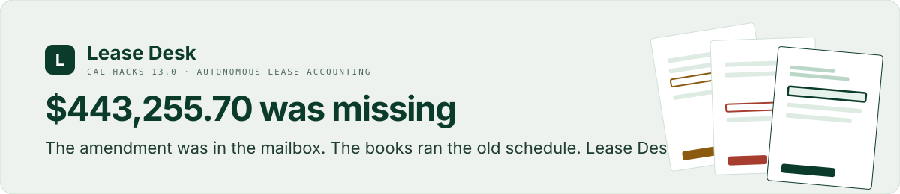
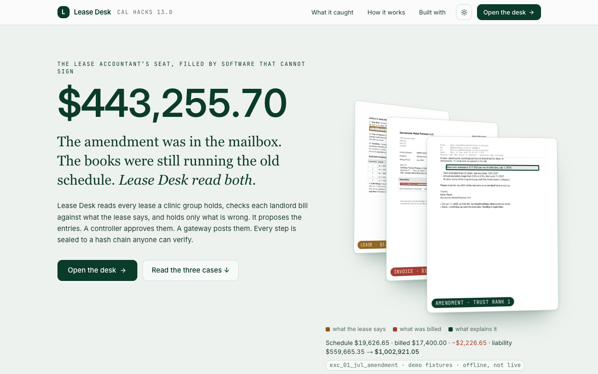
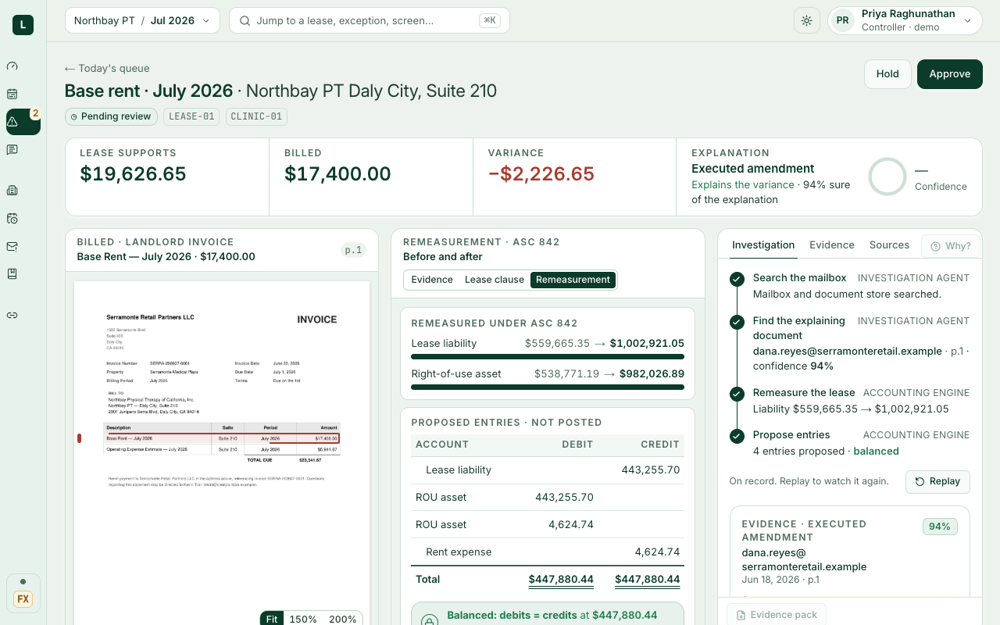
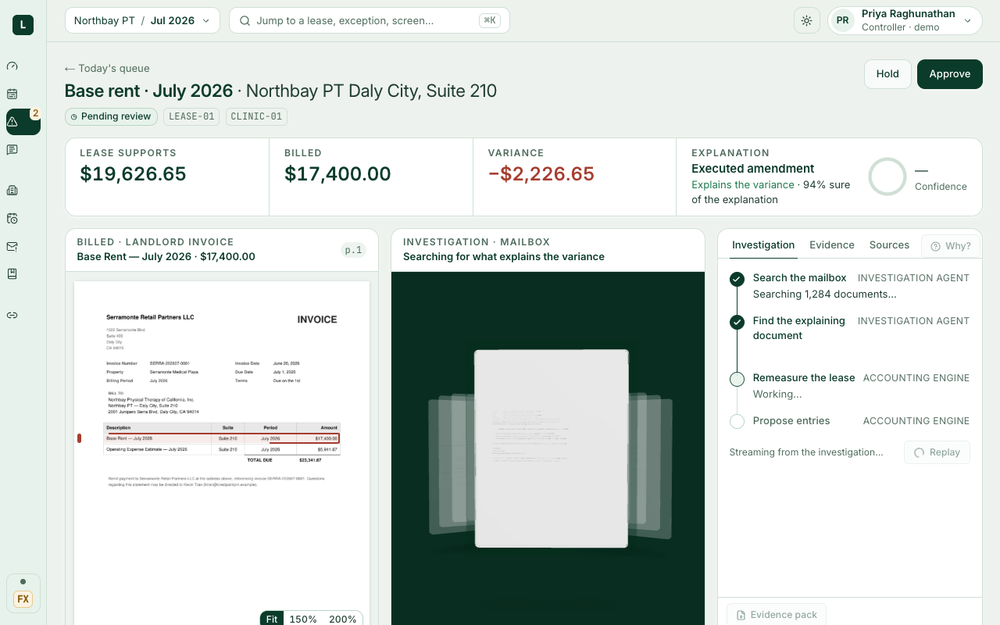
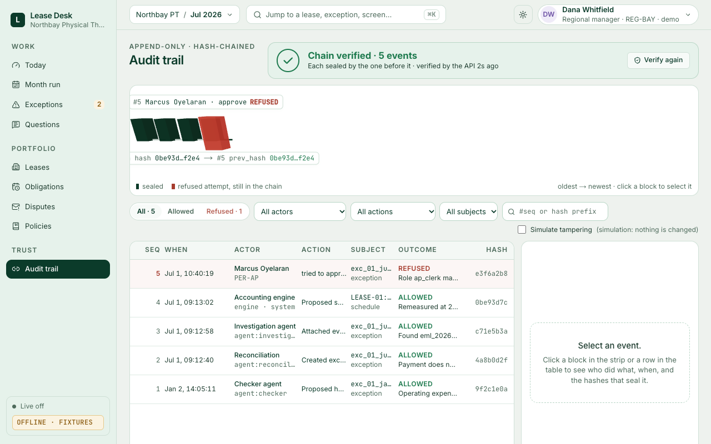
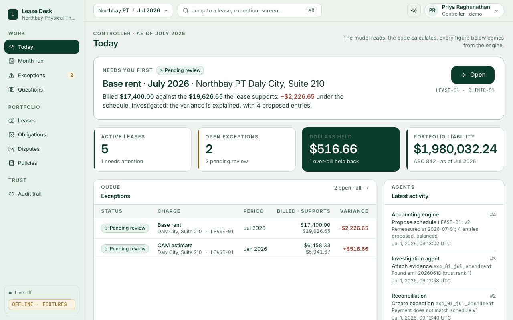
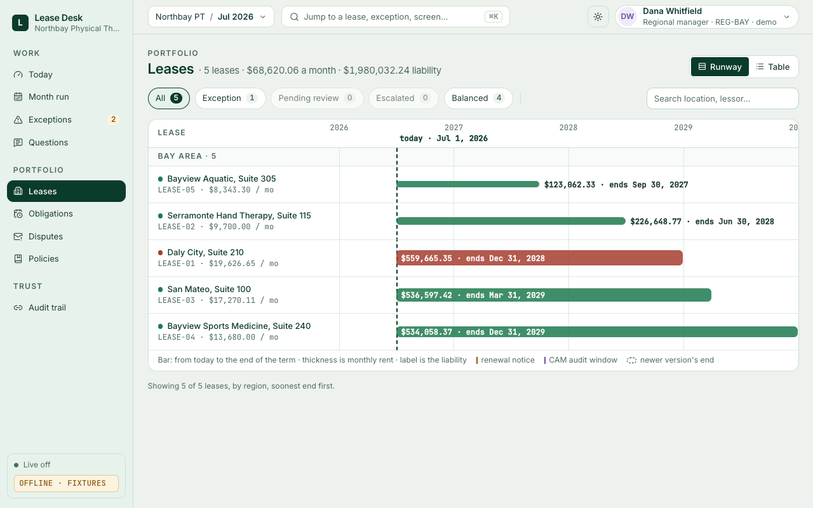

<a name="readme-top"></a>

<p align="center">
  <picture>
    <source media="(prefers-color-scheme: dark)" srcset="docs/assets/banner-dark.svg">
    <source media="(prefers-color-scheme: light)" srcset="docs/assets/banner-light.svg">
    
  </picture>
</p>

<p align="center">
  <a href="https://github.com/sarvesh172000/lease-desk/actions/workflows/ci.yml"></a>
  
  
  
  
  
  
</p>

<h3 align="center">Reads every lease. Checks every landlord bill. Holds only what is wrong, and waits for a person.</h3>

<p align="center">
  <a href="#the-moment"><b>The moment</b></a> &nbsp;·&nbsp;
  <a href="#how-it-works"><b>How it works</b></a> &nbsp;·&nbsp;
  <a href="#the-screens"><b>The screens</b></a> &nbsp;·&nbsp;
  <a href="#how-we-know-it-works"><b>How we know</b></a> &nbsp;·&nbsp;
  <a href="#who-can-do-what"><b>Who can do what</b></a> &nbsp;·&nbsp;
  <a href="#quick-start"><b>Quick start</b></a> &nbsp;·&nbsp;
  <a href="docs/DESIGN.md"><b>Design</b></a>
</p>

<br>

**Lease Desk fills the lease accountant's seat.** A clinic group holds dozens of leases, each its own rulebook:
escalations, CAM caps, proportionate shares, amendments that go to facilities and never reach accounting.
Lease Desk reads each lease, builds the ASC 842 schedules, checks every landlord charge against what the lease
actually says, holds only the money that is wrong, and when a bill doesn't match, goes looking in the mailbox
for why.

It never pays and never signs off. A person approves, under role checks the database itself enforces, and
every action, allowed or refused, is sealed to a hash-chained audit trail.

**Try it live:** [lease-desk-ten.vercel.app](https://lease-desk-ten.vercel.app) · sign in as
`priya.raghunathan@northbaypt.example`, password `demo` (the controller) · open the July hold on LEASE-01.

<table>
  <tr>
    <td align="center" width="25%" valign="top">
      <h3 align="center">$443,255.70</h3>
      <sub>of lease liability found missing from the balance sheet, from one under-billed invoice and one email</sub>
    </td>
    <td align="center" width="25%" valign="top">
      <h3 align="center">5 / 5 · 0 false</h3>
      <sub>planted errors held, zero false holds, every hold citing the clause that proves it, scored against an answer key the checker has never read</sub>
    </td>
    <td align="center" width="25%" valign="top">
      <h3 align="center">3 / 3 refused</h3>
      <sub>forged sender, property manager's claim, injection attempt: none can modify a lease, and the refusals are on the chain</sub>
    </td>
    <td align="center" width="25%" valign="top">
      <h3 align="center">0 posted by an agent</h3>
      <sub>the agent's database role cannot write the ledger; Postgres refuses it, and the refusal is sealed to the audit chain</sub>
    </td>
  </tr>
</table>

## The moment

> **CLINIC-01's lease was amended in June:** three more years, lower rent. The amendment went to facilities and
> never reached accounting. In July the landlord billed the new rent, and the books kept running the old schedule.

This runs live in the app, from `make demo-data`, in four beats:

| | Beat | What the system does |
|---|---|---|
| 1 | **The break** | July base rent is billed **$17,400.00**; the schedule says **$19,626.65**. An under-bill is a signal, not a gift. The checker holds the **−$2,226.65** and boxes the invoice line and the lease clause it rests on. |
| 2 | **The search** | *Run investigation* searches the mailbox (10 documents) and finds the countersigned amendment from the landlord's authorised representative, trust rank 1: *"Base rent reduced to $17,400 per month effective July 1, 2026."* A property manager's claim, a forged sender and an injection attempt are set aside. |
| 3 | **The proof** | The engine remeasures the lease under ASC 842: liability **$559,665.35 → $1,002,921.05 (+$443,255.70)**, ROU asset +$443,255.70. |
| 4 | **The entries** | Four adjusting entries, **balanced**, proposed for the controller's sign-off. Nothing posts until a person approves. |

| Account | Debit | Credit |
|---|---:|---:|
| Lease liability | | 443,255.70 |
| ROU asset | 443,255.70 | |
| ROU asset | 4,624.74 | |
| Rent expense | | 4,624.74 |
| | **447,880.44** | **447,880.44** |

The model's answers behind this are committed (`data/reference/llm_cache`), so the whole story replays with
**no API key and no network**, and `backend/tests/platform/test_the_moment.py` proves it on every push.

<p align="right"><a href="#readme-top">back to top ↑</a></p>

## How it works

```
  read  ──►  check  ──►  hold  ──►  a person approves  ──►  the gateway posts  ──►  the chain seals it
 Claude      code        code       controller / RM          lease_gateway role       audit_event, hashed
```

**The model reads. The code calculates.** Claude reads lease PDFs, scanned amendments and email threads and
returns structured terms, each carrying the exact sentence it came from (checked against the page before any
number reaches a schedule) and an explicit list of what it could not determine. Every schedule, balance and
journal entry is ordinary arithmetic with a test suite, reproducible to the cent, identical on every run. A
wrong extraction is a **reviewable error**, never a silently wrong balance sheet.

| Step | Who | What |
|---|---|---|
| **Read** | Claude (`backend/app/agents`, `backend/app/llm`) | Leases, amendments, bills, the mailbox. Structured outputs, per-claim citations, untrusted documents fenced. |
| **Check** | the checker (`backend/app/agents/checker`) | Every charge of the month against the schedule its lease implies: base rent, escalations, CAM, premises, duplicates. |
| **Hold** | the work layer | Only what it can prove wrong, with the invoice line and the clause boxed on the page. The rest pays. |
| **Investigate** | the investigation agent | Searches the mailbox for what explains a variance, ranks sources by trust (executed amendment first, payment history last), refuses what cannot modify a lease. |
| **Approve** | a person | Controller or regional manager, in their own region, never on their own answer. |
| **Post** | `lease_gateway` | The one database role that may write the journal, the outbox and the golden tables. |
| **Seal** | `audit_event` | Every event hashed to the one before it. Anyone can verify; an edit shows as a break. |

<p align="right"><a href="#readme-top">back to top ↑</a></p>

## The screens

<p align="center">
  
  <br><sub><b>Welcome.</b> The number, and the three pages it came from: lease clause, invoice line, amendment, each boxed where the system read it. Scroll walks the case.</sub>
</p>

<p align="center">
  
  <br><sub><b>The money screen.</b> What was billed, what the lease supports, the clause boxed on the page, the remeasurement, the entries, and Why?, answered from the audit trail.</sub>
</p>

<table>
  <tr>
    <td width="50%" valign="top">
      
      <br><sub><b>Run investigation.</b> The mailbox as a stack of the case's own pages; the explaining document lifts out, then the liability counts up to the engine's figure.</sub>
    </td>
    <td width="50%" valign="top">
      
      <br><sub><b>Audit trail.</b> Every event a block, refused attempts in red and still in the chain. Click a block to see who, when, and the hashes that seal it. "Simulate tampering" cracks the chain on screen; the verdict always comes from the API.</sub>
    </td>
  </tr>
  <tr>
    <td width="50%" valign="top">
      
      <br><sub><b>Today.</b> What needs you first, by role: the controller's hero, the regional manager's region, the AP clerk's batch readiness, the auditor's chain.</sub>
    </td>
    <td width="50%" valign="top">
      
      <br><sub><b>Leases.</b> The runway: a bar per lease from the business clock to its end, obligations as ticks, a newer version's end ghosted. Lease detail shows Claude's reading with every term boxed on the page.</sub>
    </td>
  </tr>
</table>

Light is the default; dark is a toggle. 13 px minimum type, AA contrast on every surface, reduced motion
shows every animation's final frame, and the whole path works offline on fixtures.

<p align="right"><a href="#readme-top">back to top ↑</a></p>

## How we know it works

Measured against things we did not write: a generated company with planted errors and an answer key, a
held-out company from a seed never used in development, and adversarial documents. `make eval`,
25 Oct 2026, seed 20261023; the web app shows these figures with that date, and live ones when the API answers.

| Section | Result |
|---|---|
| Checking | **5 / 5 planted errors held, 0 false holds**; $25,736.36 flagged, exactly the expected amount |
| Citations | 5 / 5 holds cite the lease clause that proves them |
| Extraction (`--extraction`, with Claude) | **65 / 65 lease fields correct** across the 5 leases, every one cited to its page |
| Investigation | The July variance settled to the amendment, confidence 100%; four entries, balanced; never posts alone |
| Safety | 3 / 3 unauthorized sources refused; instructions planted in documents are fenced, not followed |
| Held-out company | 18 clinics from an unseen seed, 4 / 4 invariants hold |
| Limits (`make prove-limits`) | An agent tried to approve: refused by `can()`. A manager tried to approve her own answer: refused. An agent tried to post: **Postgres refused**. All three on the chain; `verify_chain(): OK` |
| Tests | 1,662 backend (1,000+ against a real Postgres 16) · 141 frontend · every one offline |

**Real vs simulated.** The company, its leases, invoices and mailbox are generated deterministically from a
seed, so there is an answer key to score against. The ASC 842 engine, the database, the permissions, the
agents and the model calls are real. Reference data is real: three SEC EDGAR lease exhibits with 33
hand-verified labels, and 184 BLS CPI observations for escalations.

<details>
<summary><b>The judge's path, timed</b></summary>
<br>

[`frontend/docs/REHEARSAL.md`](frontend/docs/REHEARSAL.md) walks the demo end to end with a headless browser
(`frontend/scripts/rehearsal-walk.mjs`): welcome → login → Today → money screen → investigation → Why? →
evidence pack → regional manager → uphold → disputes → audit → month run → leases → lease detail. Every
screen usable in 100–400 ms, 7.5 s of it the investigation's own replay, 0 console errors, no 4xx on the
path, cold loads under 400 ms. Repeated in light, reduced motion, offline on fixtures, and as each role.

</details>

<p align="right"><a href="#readme-top">back to top ↑</a></p>

## Who can do what

The system runs as four database roles, and the limits are **grants, not policy**:

| Role | For | Cannot |
|---|---|---|
| `lease_agent` | The worker and agents: reads records, writes ingestion, drafts and work | touch the ledger, the outbox or the golden tables |
| `lease_gateway` | The only writer back to records: golden tables, the journal, the outbox, period status | act without a person's approval on record |
| `lease_api` | Serves the UI: writes events and work items | write the ledger |
| `lease_reader` | The auditor: read-only on everything | write anything |

Nobody, the owner included, can rewrite or delete `audit_event`. A regional manager cannot approve another
region's item, and nobody approves their own proposal. Refusals are recorded in the audit trail too.
`make prove-roles` has each role try a forbidden write and shows the database refusing.

<p align="right"><a href="#readme-top">back to top ↑</a></p>

## Built with

| | Where | What it does here |
|---|---|---|
| **Claude** · Anthropic | `backend/app/agents`, `backend/app/llm` | Reads the documents. Structured outputs, per-claim citations, untrusted content fenced; answers cached and replayable |
| **Fetch.ai / ASI:One** | [`agents_fetch/`](agents_fetch/README.md) | Four uAgents on Agentverse: the whole desk inside an ASI:One chat, as yourself (one-time pairing code), under the same permissions as the web app |
| **SpacetimeDB** | [`spacetime/`](spacetime/README.md), `backend/app/work/live.py` | Every committed approval mirrored live, so other screens update with no refresh; agents publish each step. Postgres stays the system of record |
| **Azure** | [`docs/DEPLOY.md`](docs/DEPLOY.md) | The API, worker, Postgres and agents on Azure Container Apps |
| **Postgres 16** | `backend/app/db` | Four roles with exact grants, the hash-chained `audit_event`, event-sourced work |
| **Python 3.13 · FastAPI** | `backend/` | ASC 842 schedules, CAM pools, CPI, remeasurement, journal entries. Deterministic, with a test suite |
| **Next.js 15** | `frontend/` | Formats and asserts what the API says. Does no lease accounting of its own |

<details>
<summary><b>The Fetch.ai agents</b></summary>
<br>

| Agent | Name | Address |
|---|---|---|
| Front desk | `Northbay Lease Desk` | `agent1qg2tetdj6qf5wnf744mvvtz66rzfrmvqkx5dcejzpg78q3prt9aa58j2g0g` |
| Rulebook | `lease_desk_rulebook` | `agent1qtqqwygy3z7uc2ypu4qsc2dklqmuadvgy23mwpl54wqccl02sp3ag4pn3ud` |
| Investigation | `lease_desk_investigation` | `agent1q2mr89mwmdn0l8wj5t5uyzpd09fhfq8mvs037zf44wsvlt0znamqqkmg0l9` |
| Approvals | `lease_desk_approvals` | `agent1qgfyhfmc2ngygsck8f3xllf9mqr7plc8dv82czjjn9f3gh4psjcrjczh4dg` |

Setup, pairing and what to say: [`agents_fetch/README.md`](agents_fetch/README.md).

</details>

<p align="right"><a href="#readme-top">back to top ↑</a></p>

## Quick start

**Prerequisites:** Python 3.11+ (macOS ships 3.9, which ReportLab will not run on), Node 20+, Docker with
Compose v2.

```bash
git clone https://github.com/sarvesh172000/lease-desk.git && cd lease-desk
python3.13 -m venv .venv && ./.venv/bin/pip install -r requirements.txt
docker compose up -d db                # Postgres 16 on host port 5433
make demo                              # database, January and July, API :8000, web app :3000
```

Open http://localhost:3000, sign in as `priya.raghunathan@northbaypt.example` (password `demo`, the
controller), and open the July hold on LEASE-01. Demo mode has a switcher for every role.

No API key is needed: the model's answers the demo uses are committed. With `ANTHROPIC_API_KEY` set,
anything not cached calls Claude.

<details>
<summary><b>Develop</b></summary>
<br>

```bash
make up migrate seed      # Postgres, api and worker; schema and roles; the company
make prove-roles          # each role tries a forbidden write; the database refuses
make prove-limits         # three forbidden actions refused and on the chain
make test                 # the whole suite (database tests run when Postgres is up)
make eval                 # generate the world and score a run against the answer key
make lint                 # ruff on the scope in ruff.toml
make ci                   # lint, the suite with database tests required, the eval
```

Frontend: `cd frontend && npm ci && npm run build && npm run lint && npm test`. `NEXT_PUBLIC_USE_FIXTURES=1`
runs the web app offline on its fixtures; `frontend/scripts/sync_fixture_docs.mjs` keeps those fixtures in
line with a live desk.

Compose publishes Postgres on host port **5433** so it never collides with a local one. Every setting has a
default, so `.env` is optional (copy `.env.example`). Platform tests migrate a throwaway database and drop it;
CI loads `ci/require_db.py`, which turns any skipped database test into a failure. GitHub Actions runs lint,
the suite and the eval against Postgres 16, `make migrate seed prove-roles` on a fresh database, and the
frontend's lint, build and tests.

</details>

<details>
<summary><b>The accounting</b></summary>
<br>

Operating lease under ASC 842, payments in advance:

```
liability₀    = PV of all payments at the IBR
rou₀          = liability₀ + prepaid − incentives
straight_line = total payments / term months
interestₜ     = (liabilityₜ − paymentₜ) × (IBR / 12)
liabilityₜ₊₁  = liabilityₜ − paymentₜ + interestₜ
rou_amortₜ    = straight_line − interestₜ
```

A modification that isn't a separate contract remeasures the liability at the revised payments and rate, with
the difference booked against the ROU asset. Months already closed on the stale schedule get a rent-expense
catch-up.

</details>

<p align="right"><a href="#readme-top">back to top ↑</a></p>

## Layout

| Path | What's in it |
|---|---|
| `backend/app/` | FastAPI API, the work layer (states, transitions, gateway), agents, LLM layer, engine, jobs |
| `frontend/` | Next.js 15 web app: welcome, Today, the money screen, month run, leases, obligations, disputes, policies, audit trail |
| `agents_fetch/` | The Fetch.ai / ASI:One agents |
| `spacetime/` | The SpacetimeDB module for the live mirror and agent feed |
| `datagen/` | The generated company, its documents and the answer key |
| `eval/` | Scores a run against the answer key |
| `leasedesk/` | The original engine package (schedule, reconcile, remeasure) |
| `data/reference/` | SEC EDGAR exhibits, BLS CPI, and the committed model answers |
| `docs/` | [Design](docs/DESIGN.md) · [security review](docs/SECURITY.md) · [plan](docs/PLAN.md) · [deploy](docs/DEPLOY.md) · [sponsors](docs/SPONSORS.md) |

## Status

**Built and tested:** abstraction, the ASC 842 engine, checking, the investigation and remeasurement,
approvals through the gateway, the hash-chained audit, policies, disputes, obligations, the web app, the
ASI:One agents and the SpacetimeDB mirror.

**Not yet:** extraction scored on the real SEC exhibits (the schema needs optional fields first, so a lease
that is silent on a term isn't forced to answer), finance-lease classification, and variable or percentage
rent.

## License

[MIT](LICENSE). Built at Cal Hacks 13.0 by Sarvesh Waghmare and Jenil.

<p align="right"><a href="#readme-top">back to top ↑</a></p>
