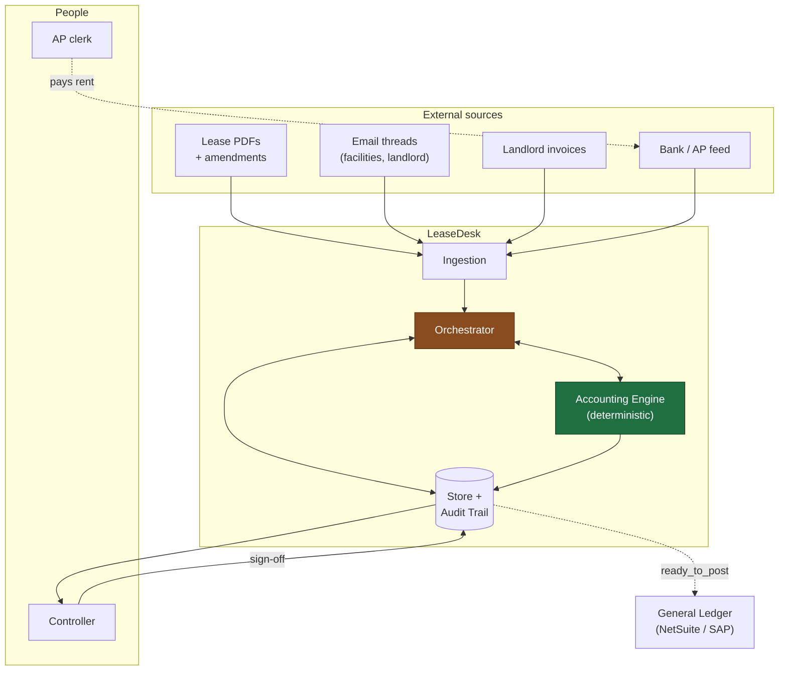
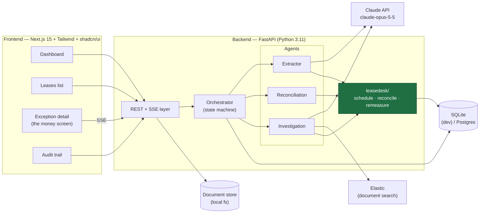
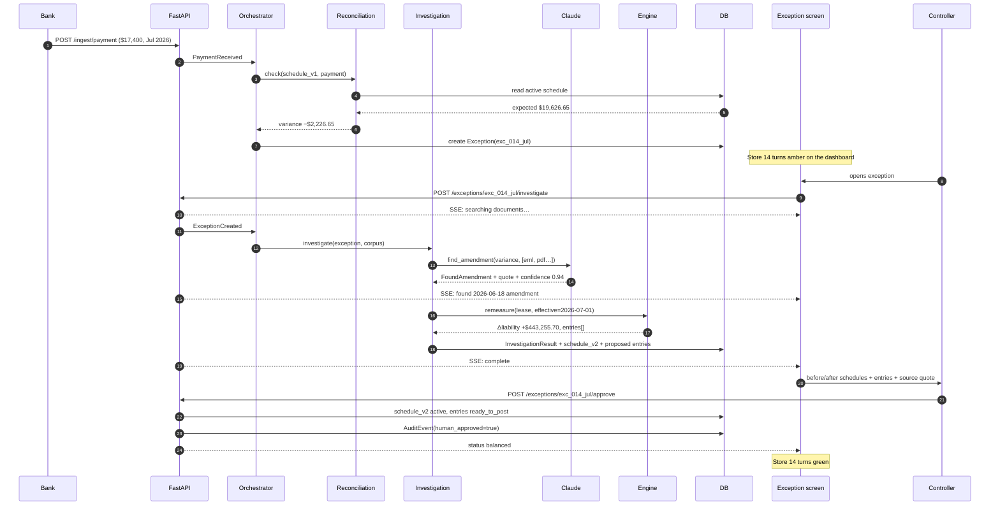
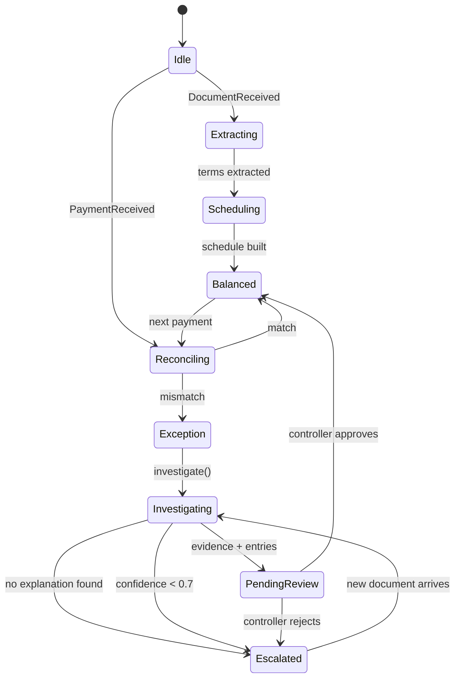
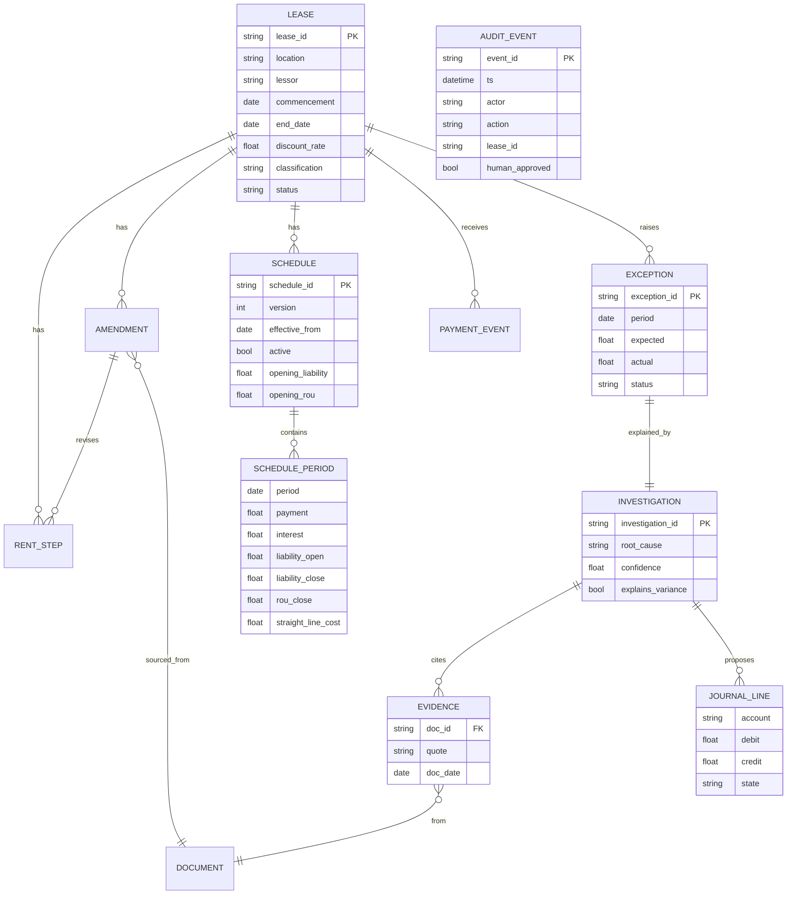

# LeaseDesk — Architecture

Diagrams render on GitHub. Three levels: system context, container/component,
and the runtime sequence for the exception path.

---

## 1. High level — system context



**Read it as:** everything enters through ingestion, the orchestrator decides
which agent runs, the engine does all arithmetic, and nothing reaches the GL
without a controller's signature.

---

## 2. Container level — what runs where



### Why FastAPI and not Next.js API routes

The accounting engine is already written and tested in Python. Wrapping it in
FastAPI costs about two hours. Reimplementing ASC 842 amortization in
TypeScript costs a day and throws away the test suite. **Do not rewrite the
engine.**

---

## 3. Low level — the exception path

The demo flow, end to end. This is the sequence to rehearse.



---

## 4. Low level — orchestrator state machine



`Escalated` is a first-class state, not an error path. Show it in the demo.

---

## 5. Data model



`AUDIT_EVENT` has no foreign keys by design — it is append-only and must
survive anything being deleted or superseded.

---

## 6. API surface

Build in this order. The first four are the demo.

| # | Method | Path | Returns | Needed by |
| --- | --- | --- | --- | --- |
| 1 | `GET` | `/api/leases` | Portfolio list with status | Dashboard, Leases |
| 2 | `GET` | `/api/exceptions` | Open exceptions | Dashboard |
| 3 | `GET` | `/api/exceptions/{id}` | Exception + investigation + entries + schedules | Exception screen |
| 4 | `POST` | `/api/exceptions/{id}/approve` | New status | Sign-off |
| 5 | `POST` | `/api/exceptions/{id}/investigate` | **SSE** event stream | The timeline |
| 6 | `GET` | `/api/leases/{id}/schedule?version=` | Schedule rows | Before/after view |
| 7 | `GET` | `/api/audit?lease_id=` | Audit events | Audit trail |
| 8 | `POST` | `/api/ingest/payment` | Match result | Live payment demo |
| 9 | `POST` | `/api/ingest/document` | Extracted terms | Live upload demo |

### SSE event shape

```json
{"stage": "searching",  "message": "Searching 1,284 documents…"}
{"stage": "found",      "doc_id": "eml_20260618", "quote": "Base rent reduced to $17,400 per month effective July 1, 2026.", "confidence": 0.94}
{"stage": "remeasured", "liability_delta": 443255.70, "rou_delta": 443255.70}
{"stage": "complete",   "entries": 4, "balanced": true}
```

Four events is enough for a timeline that feels alive. Do not over-engineer it.

---

## 7. Frontend structure

```
web/
├── app/
│   ├── page.tsx                      # Dashboard
│   ├── leases/page.tsx               # Portfolio list
│   ├── leases/[id]/page.tsx          # Lease detail + schedule
│   ├── exceptions/[id]/page.tsx      # THE MONEY SCREEN
│   └── audit/page.tsx                # Audit trail
├── components/
│   ├── MetricTile.tsx                # Active leases, open exceptions, STP %
│   ├── StatusBadge.tsx               # balanced | exception | pending_review
│   ├── InvestigationTimeline.tsx     # consumes SSE
│   ├── ScheduleDiff.tsx              # before/after, side by side
│   ├── JournalEntryTable.tsx         # debits/credits + balance assertion
│   ├── EvidenceCard.tsx              # quote + source doc + confidence
│   └── AgentActivityFeed.tsx         # three agents, last action each
└── lib/api.ts                        # typed fetch wrappers
```

**Build `ScheduleDiff` and `JournalEntryTable` against hardcoded JSON first.**
They are the two components the demo lives on; they must not be blocked waiting
for the API.

---

## 8. Deployment for demo day

Keep it local. Do not deploy.

| Concern | Decision |
| --- | --- |
| Where it runs | `localhost` — two terminals, FastAPI on :8000, Next on :3000 |
| Why not deployed | Venue Wi-Fi is the single most common demo failure |
| Network dependency | Only the Claude API, and only on `--live` / investigate |
| Offline fallback | Stored-amendment path needs no network at all |
| Backup | Recorded video on disk by H12 |

Run the whole demo once with Wi-Fi off and know exactly which step breaks.
