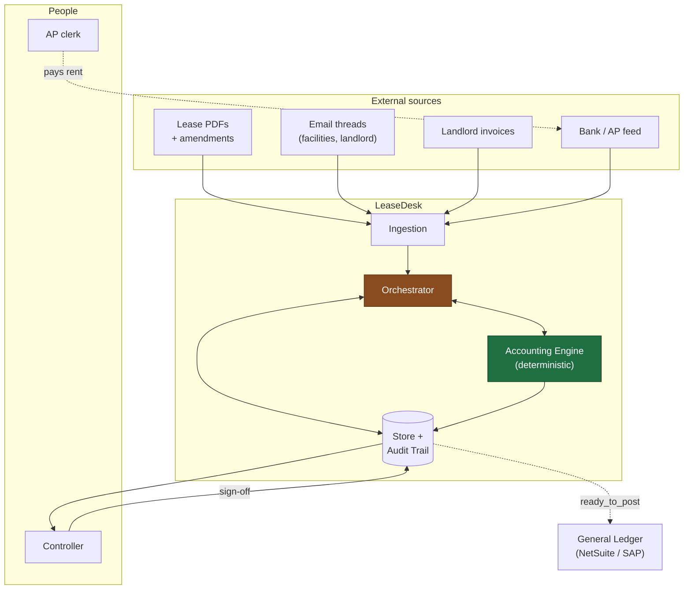
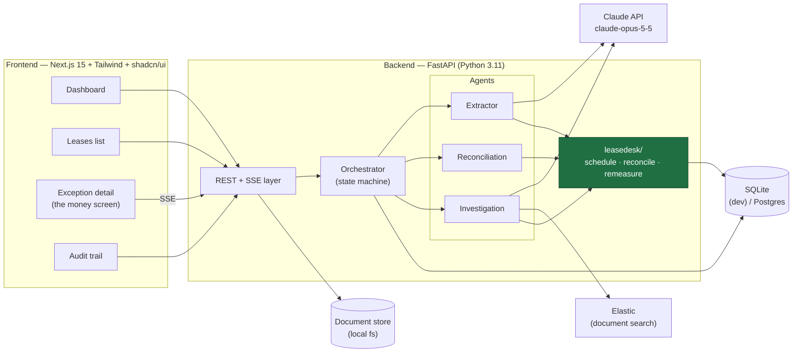
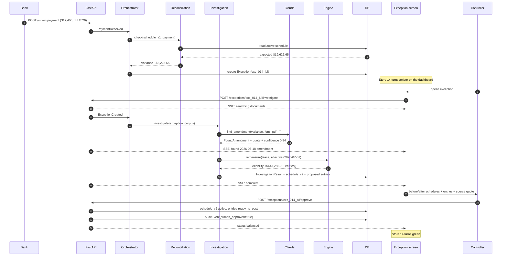
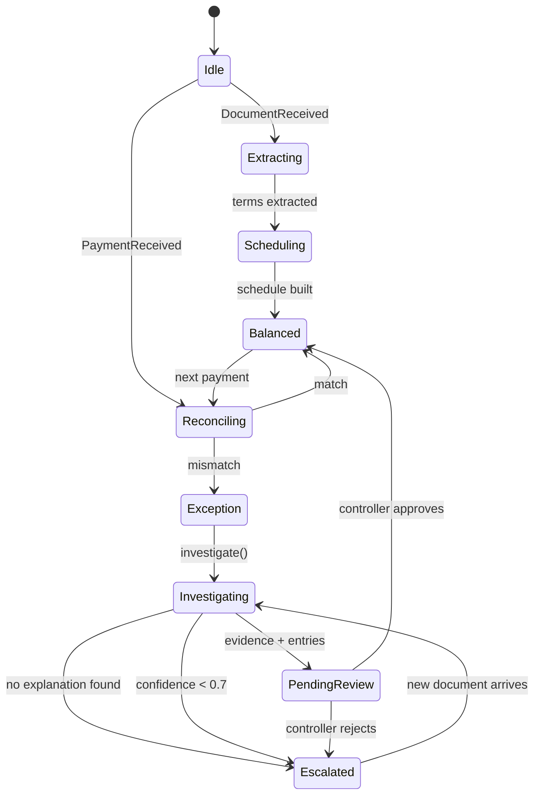
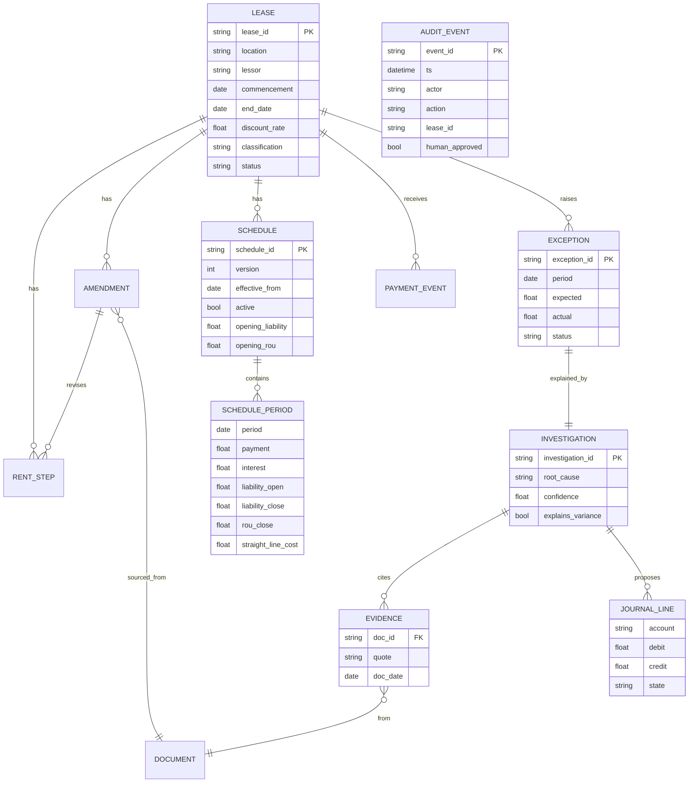

# Design

How LeaseDesk works: the principle it rests on, the trust model, the agents,
the accounting, and the diagrams.

Reference material — read it when you need it. [`PLAN.md`](PLAN.md) is what to
build and in what order.

---

The critical path is ingest → extract → schedule → match → investigate →
approve. Everything below serves it.

## 1. The thesis

Lease accounting breaks for one reason: **the schedule is only correct until
someone signs an amendment, and nobody tells accounting.** The amendment lands
in a facilities inbox. The AP team pays the new amount because the landlord
invoiced it. The books keep running the old schedule. Nobody notices until
audit.

LeaseDesk closes that loop. It reconciles cash against the schedule
continuously, and a variance is what *triggers* a search for the document that
explains it.

## 2. The one principle everything else follows from

**The model reads. The code calculates.**

| Layer | Who does it | Why |
| --- | --- | --- |
| "What does this document say the rent is?" | Claude | Messy PDFs, email threads, inconsistent language |
| "What is the liability at 2026-07-01?" | Deterministic Python | Must be reproducible, auditable, and identical every run |
| "Which document explains this variance?" | Claude, with evidence | Search + reasoning over a document corpus |
| "What are the adjusting entries?" | Deterministic Python | Debits must equal credits, always |

No balance, schedule row or journal entry is ever produced by a language model.
A wrong extraction becomes a *reviewable* error instead of a silently wrong
balance sheet. This is the sentence that makes the product credible to a
controller, and it is the sentence to say out loud in the demo.

## 3. Trust model

Three gates, in order. Nothing skips a gate.

1. **Evidence.** Every extracted term carries the exact sentence it came from
   and a pointer to the source document. A claim with no quote is not a claim.
2. **Confidence.** Every investigation returns a score. Below threshold it does
   not propose entries — it escalates with what it found and what it could not
   determine.
3. **Human sign-off.** Proposed entries are *proposed*. A controller approves
   before anything is marked ready to post. The approval itself is an audit
   event.

### What happens when the agent is wrong

This is the question judges will ask, so it is a design requirement, not a
disclaimer:

- The agent cannot write a schedule. It can only propose a set of lease terms,
  which the deterministic engine then turns into a schedule.
- If extraction is wrong, the proposed entries are wrong — and visibly so,
  because the controller sees the before/after schedules and the source quote
  side by side before approving.
- If no document explains the variance, the exception is routed to a human with
  `root_cause: unexplained`. **Ship one of these in the demo.** A system that
  knows what it doesn't know reads as far more serious than one that is always
  confident.

## 4. Agents

Three, with a sequential orchestrator. No agent framework.

| Agent | Input | Output | Runs when | Model |
| --- | --- | --- | --- | --- |
| **Extractor** | Lease PDF / amendment email text | Structured lease terms + quotes + `uncertain[]` | New document | `claude-opus-5-5` |
| **Reconciliation** | Payment events + active schedule | Match or `Exception` | Every payment | Rules only — no LLM |
| **Investigation** | Exception + document corpus | `InvestigationResult` with evidence | Only on exception | `claude-opus-5-5` |

Deliberate choices:

- **Reconciliation uses no LLM.** Comparing two numbers is not a reasoning task.
  Putting a model there would be slower, cost money, and occasionally be wrong
  about arithmetic.
- **Investigation runs only on exceptions.** It is the expensive call. On a
  clean portfolio it never fires.
- **The orchestrator is a function, not a framework.** LangGraph buys nothing
  here and costs hours.

## 5. Data model

```
Lease ─┬─ RentStep[]        (a block of months at a fixed rent)
       ├─ Amendment[]       (what changed, effective when, from which source)
       └─ Schedule[]        (versioned; v1 original, v2 post-amendment)
                └─ Period[]  (monthly rows)

PaymentEvent ──▶ matched against Schedule.Period
                      │
                      └─ mismatch ──▶ Exception
                                          └─ InvestigationResult
                                                 ├─ Evidence[]      (quote + source doc)
                                                 └─ JournalLine[]   (proposed, unposted)

AuditEvent[]  — append-only, every action by every actor
```

`Lease.as_of(date)` applies every amendment effective on or before a date. This
is what makes before/after comparison trivial: build the schedule from
`as_of(amendment_date - 1)` and from `as_of(today)` and diff them.

## 6. The accounting

**Operating lease under ASC 842, payments in advance.** This matters: retail
stores, clinics and warehouses are almost always operating leases, which present
a *single straight-line lease cost* — not a principal/interest split. Presenting
them as a finance lease is the fastest way to lose an accountant judge.

```
liability₀    = PV of all payments at the IBR
rou₀          = liability₀ + prepaid − incentives
straight_line = total payments ÷ term months
interestₜ     = (liabilityₜ − paymentₜ) × (IBR ÷ 12)
liabilityₜ₊₁  = liabilityₜ − paymentₜ + interestₜ
rou_amortₜ    = straight_line − interestₜ        ← the ROU plug
```

### Remeasurement

A modification that is not a separate contract: remeasure the liability at the
revised payments and discount rate, and book the difference **against the ROU
asset** — no immediate P&L. Months already closed on the stale schedule get a
rent-expense catch-up.

```
Δliability = PV(revised remaining payments) − carrying liability
Δrou       = Δliability
catchup    = Σ(correct straight-line) − Σ(booked straight-line), over closed months
```

Verified on the sample lease: liability $559,665.35 → $1,002,921.05
(+$443,255.70), ROU $538,771.19 → $982,026.89, catch-up −$4,624.74, debits =
credits = $447,880.44.

## 7. Request flow

```
POST /api/ingest/document
  → Extractor → Lease terms → Accounting Engine → Schedule v1

POST /api/ingest/payment
  → Reconciliation → match? → done
                   → mismatch? → Exception created

POST /api/exceptions/{id}/investigate      (SSE stream)
  → Investigation → searches corpus → Evidence
  → Accounting Engine → Schedule v2 → Δ → proposed JournalLine[]
  → status: pending_review

POST /api/exceptions/{id}/approve
  → Schedule v2 becomes active
  → entries marked ready_to_post
  → AuditEvent(human_approved=true)
  → status: balanced
```

The investigate call streams over SSE. That is what makes the demo feel alive
without faking anything — the timeline fills in as the agent actually works.

## 8. What is deliberately out of scope

| Not building | Why |
| --- | --- |
| Finance-lease classification | Everything here is operating; adding both doubles the test surface for zero demo value |
| Variable / percentage rent, CPI escalation | Real, but invisible in a 2-minute demo |
| Scanned-PDF OCR | Unbounded debugging; the sample corpus is text |
| Multi-entity consolidation | Nobody understands why it matters in 2 minutes |
| Chat interface | Invites judges to break it live, and prose answers undercut the determinism pitch |
| Actual GL posting | `ready_to_post` is the honest boundary for a hackathon |

## 9. Failure modes and what the system does

| Failure | Behaviour |
| --- | --- |
| Extraction returns a term it isn't sure of | Lands in `uncertain[]`, surfaced in UI, never silently defaulted |
| No document explains a variance | `root_cause: unexplained`, escalated to a human, no entries proposed |
| Investigation confidence below threshold | Evidence shown, entries withheld, human decides |
| Two amendments affect the same months | Applied in `effective` order; later wins on overlapping steps |
| Payment arrives for an unknown lease | Logged unmatched, does not create a false exception |
| Claude API unavailable | Reconciliation and schedules still work; investigation degrades to manual |

## 10. Demo-critical invariants

Hold these or the demo breaks:

- Debits equal credits on every proposed entry set. Assert it in code.
- Liability and ROU both amortize to zero at term end. Tested.
- The schedule is reproducible — same inputs, same numbers, every run.
- `--live` and stored-amendment paths produce the same remeasurement.

---

## 11. High level — system context



**Read it as:** everything enters through ingestion, the orchestrator decides
which agent runs, the engine does all arithmetic, and nothing reaches the GL
without a controller's signature.

---

## 12. Container level — what runs where



### Why FastAPI and not Next.js API routes

The accounting engine is already written and tested in Python. Wrapping it in
FastAPI costs about two hours. Reimplementing ASC 842 amortization in
TypeScript costs a day and throws away the test suite. **Do not rewrite the
engine.**

---

## 13. Low level — the exception path

The demo flow, end to end. This is the sequence to rehearse.



---

## 14. Orchestrator state machine



`Escalated` is a first-class state, not an error path. Show it in the demo.

---

## 15. Data model (ER)



`AUDIT_EVENT` has no foreign keys by design — it is append-only and must
survive anything being deleted or superseded.

---

## 16. API surface

Build in this order. The first four are the demo.

| # | Method | Path | Returns | Needed by |
| --- | --- | --- | --- | --- |
| 1 | `GET` | `/api/leases` | Portfolio list with status | Dashboard, Leases |
| 2 | `GET` | `/api/exceptions` | Open exceptions | Dashboard |
| 3 | `GET` | `/api/exceptions/{id}` | Exception + investigation + entries + schedules | Exception screen |
| 4 | `POST` | `/api/exceptions/{id}/approve` | New status | Sign-off |
| 5 | `POST` | `/api/exceptions/{id}/investigate` | **SSE** event stream | The timeline |
| 6 | `GET` | `/api/leases/{id}/schedule?version=` | Schedule rows | Before/after view |
| 7 | `GET` | `/api/audit?lease_id=` | Audit events | Audit trail |
| 8 | `POST` | `/api/ingest/payment` | Match result | Live payment demo |
| 9 | `POST` | `/api/ingest/document` | Extracted terms | Live upload demo |

### The contract — freeze this first

**Person B builds every screen against these fixtures. Person A makes the API
return this shape. Neither waits for the other.** Values below are real output
from `datagen`, so the fixtures and the live API agree.

`GET /api/leases`

```json
[{"lease_id": "LEASE-01", "clinic_id": "CLINIC-01",
  "location": "Northbay PT — Daly City — Suite 210",
  "lessor": "Serramonte Retail Partners LLC",
  "status": "exception", "monthly_rent": 19626.65,
  "liability": 559665.35, "end": "2028-12-31"}]
```

`GET /api/exceptions`

```json
[{"exception_id": "exc_01_jan_cam", "lease_id": "LEASE-01",
  "clinic_id": "CLINIC-01", "period": "2026-01-01",
  "charge_type": "cam_estimate", "expected": 5941.67, "actual": 6458.33,
  "delta": 516.66, "status": "pending_review", "confidence": 0.94}]
```

`GET /api/exceptions/{id}` — the money screen. Status is one of
`balanced`, `exception`, `pending_review`, `escalated`.

```json
{"exception_id": "exc_01_jul_amendment", "lease_id": "LEASE-01",
 "period": "2026-07-01", "expected": 19626.65, "actual": 17400.00,
 "delta": -2226.65, "status": "pending_review",
 "investigation": {
   "root_cause": "amendment", "confidence": 0.94, "explains_variance": true,
   "evidence": [{"doc_id": "eml_20260618", "date": "2026-06-18",
     "source": "dana.reyes@serramonteretail.example", "trust_rank": 1,
     "quote": "Base rent reduced to $17,400 per month effective July 1, 2026.",
     "page": 1, "box": [85.0, 125.3, 527.0, 152.1]}],
   "liability_before": 559665.35, "liability_after": 1002921.05,
   "rou_before": 538771.19, "rou_after": 982026.89,
   "entries": [
     {"account": "Lease liability", "debit": 0, "credit": 443255.70},
     {"account": "ROU asset", "debit": 443255.70, "credit": 0},
     {"account": "ROU asset", "debit": 4624.74, "credit": 0},
     {"account": "Rent expense", "debit": 0, "credit": 4624.74}],
   "balanced": true}}
```

`box` is `[x0, y0, x1, y1]` in PDF points, origin top-left. Scale it against
the page's `width` and `height` from `GET /api/documents/{sha}/pages`.

### SSE event shape

```json
{"stage": "searching",  "message": "Searching 1,284 documents…"}
{"stage": "found",      "doc_id": "eml_20260618", "quote": "Base rent reduced to $17,400 per month effective July 1, 2026.", "confidence": 0.94}
{"stage": "remeasured", "liability_delta": 443255.70, "rou_delta": 443255.70}
{"stage": "complete",   "entries": 4, "balanced": true}
```

Four events is enough for a timeline that feels alive. Do not over-engineer it.

---

## 17. Frontend structure

```
web/
├── app/
│   ├── page.tsx                      # Dashboard
│   ├── leases/page.tsx               # Portfolio list
│   ├── leases/[id]/page.tsx          # Lease detail + schedule
│   ├── exceptions/[id]/page.tsx      # THE MONEY SCREEN
│   └── audit/page.tsx                # Audit trail
├── components/
│   ├── MetricTile.tsx                # Active leases, open exceptions, STP %
│   ├── StatusBadge.tsx               # balanced | exception | pending_review
│   ├── InvestigationTimeline.tsx     # consumes SSE
│   ├── ScheduleDiff.tsx              # before/after, side by side
│   ├── JournalEntryTable.tsx         # debits/credits + balance assertion
│   ├── EvidenceCard.tsx              # quote + source doc + confidence
│   └── AgentActivityFeed.tsx         # three agents, last action each
└── lib/api.ts                        # typed fetch wrappers
```

**Build `ScheduleDiff` and `JournalEntryTable` against hardcoded JSON first.**
They are the two components the demo lives on; they must not be blocked waiting
for the API.

---

## 18. Deployment for demo day

Keep it local. Do not deploy.

| Concern | Decision |
| --- | --- |
| Where it runs | `localhost` — two terminals, FastAPI on :8000, Next on :3000 |
| Why not deployed | Venue Wi-Fi is the single most common demo failure |
| Network dependency | Only the Claude API, and only on `--live` / investigate |
| Offline fallback | Stored-amendment path needs no network at all |
| Backup | Recorded video on disk by H12 |

Run the whole demo once with Wi-Fi off and know exactly which step breaks.

---

See also: [`PLAN.md`](PLAN.md) · [`SPONSORS.md`](SPONSORS.md) · [`roadmap/`](roadmap/)
